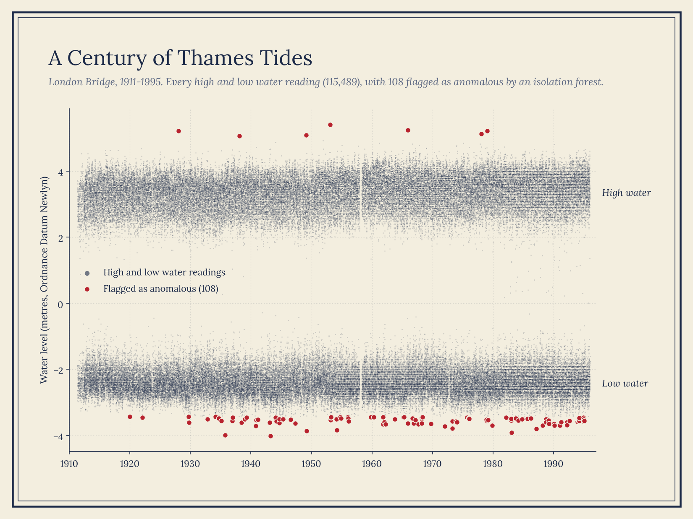

# River Thames Tidal Variation

I lived in the UK for 7 years and never lost my soft spot for British history, especially the kind that comes as a dataset. This project was a chance to dig into a century of handwritten Thames tide records, digitised in 2022. This time series analysis covers historical sea level records for every gauge along the River Thames, 1911-1995. I used an isolation forest model to identify anomalies in the water level data and plotted the results with <code>Bokeh</code>.


Methods:
- Built a reusable `tidal_stats()` function that loads each gauge's raw file, standardizes the schema (column selection, renaming, datetime and float casting), and derives year and month features
- Applied it across 13 gauges (~650k readings) and merged the outputs into a single long-format dataset keyed by location, with a row-count check to confirm nothing was lost in the merge
- Computed mean, median, and IQR separately for high- and low-water readings at each gauge
- Measured extreme-tide frequency: the share of each year's high tides above the gauge's 75th percentile, and of low tides below its 25th
- Plotted monthly mean water levels with confidence intervals, plus box plots of the full distribution, for every gauge
- Trained an unsupervised isolation forest (100 trees, 0.1% contamination) on London Bridge readings and joined the anomaly flags back to the time series
- Built an interactive Bokeh time series of high and low tides with the flagged anomalies and hover tooltips

Findings:
- London Bridge swings about 5.7 m between tides: high water averages 3.3 m and low water −2.4 m (relative to Ordnance Datum Newlyn)
- The records are far from even: London Bridge, Richmond, Southend and Tilbury cover most of the century, while All Hallows Pier has a single month and Shivering Sand a single year

<p></p>

Run it:
```bash
pip install pandas scipy matplotlib seaborn scikit-learn bokeh jupyter
jupyter notebook thames_water_levels_stats.ipynb
```
The notebooks load the data straight from this repo's `datasets/` folder. Anomaly detection is in `thames_water_levels_isolation-forest.ipynb`.

Data sources:
- [The British National Oceanography Centre](https://www.bodc.ac.uk/data/published_data_library/catalogue/10.5285/b66afb2c-cd53-7de9-e053-6c86abc0d251)
- [Digitising historical sea level records in the Thames Estuary](https://doi.org/10.1038/s41597-022-01223-7)
